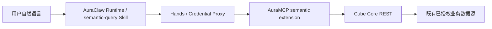

# Cube Core 语义查询一期

关联 [issue #3](https://github.com/sushaofei/AuraMCP/issues/3)。Cube Core 负责已建模指标的 SQL 编译与只读执行；自然语言理解仍由 AuraClaw 完成。



## 代码与职责

- `contracts/semantic.py`：严格结构化查询合同，拒绝 SQL、地址、身份及未知参数。
- `extensions/semantic`：三个只读 MCP 工具及安全错误码，不导入数据库驱动。
- `domain/semantic.py`：语义读取端口，不依赖 Web 或 Cube SDK。
- `infrastructure/semantic.py`：独立配置、服务端签名、模型版本检查、Cube 请求与结果归一化。
- `composition/app.py`：按 `AURAMCP_SEMANTIC_CONFIG_FILE` 显式启用并管理连接生命周期。未配置时既有行为不变。
- `deploy/semantic`：独立 Cube 服务与 AuraMCP override。原始模型、源连接配置和私钥属于私有部署；不能放入治理数据库或 Runtime。

## 工具合同

| 工具 | 输入与用途 |
|---|---|
| `auramcp.semantic.discover` | `search/offset/limit`；仅列出受信身份可见的数据集 |
| `auramcp.semantic.describe` | `dataset`；读取指标、维度、单位、时区与 `model_version`，同步核对 Cube 元数据 |
| `auramcp.semantic.query` | `dataset/model_version/measures/dimensions/filters/time/order_by/limit`；执行指标查询 |

示例必须先从 describe 获取实际字段和版本：

```json
{
  "dataset": "records", "model_version": "records-v1",
  "measures": ["count", "amount"], "dimensions": ["area"],
  "filters": [{"member":"id","operator":"gte","values":["1000"]}],
  "time": {"dimension":"published_at","start":"2026-10-01","end_exclusive":"2026-10-02","timezone":"Asia/Shanghai"},
  "limit": 50
}
```

日期范围使用模型时区的当地时间，左闭右开，最多 366 天；示例模型适用于源字段为不带时区的当地时间，其他源类型需要相应调整 SQL。公告与入库时间分别建模。`limit` 限制结果分组数，不限制聚合输入；不能用它实现“最近 N 条的汇总”。

结果含归一化 rows、单位和口径、模型版本、查询参数摘要、invocation/request ID、截断标记和新鲜度字段。数值以十进制字符串保真，null 保持 null；不把浮点返回值伪装成精确金额。`completed_at` 与 `cache_refreshed_at` 不等于业务截止时间；没有来源水位时 `data_as_of=null`。

错误包括 `ACCESS_DENIED`、`INVALID_QUERY`、`MODEL_CHANGED`、`QUERY_TIMEOUT`、`RESULT_TOO_LARGE`、`PRECISION_UNVERIFIED` 与安全的上游失败。模型变化时丢弃查询结果并重新描述；权限失败不得用旧 database 工具绕过。

## 权限与资源边界

Hands workload 与可信上下文仍在 MCP 入口校验。扩展先核对固定 tenant/user allowlist，再签发有效期 60 秒、固定 issuer/audience 的 RS256 JWT。Cube 再核对身份、dataset/version，仅开放 meta/data scope，关闭 SQL 接口；基础 cube 不公开，只公开批准的 view。

一期部署复用原有业务源账户、表/字段许可及用户范围。当前来源授权覆盖整张批准关系，故 view 使用 `allow_all`；这不提供共享表的租户行隔离。将来接入共享多租户表时，必须增加以服务端身份生成的 row policy，并按授权范围隔离模型与缓存后才能扩大可见范围。

查询缓存队列按 tenant/user/dept/dataset/version 隔离，不含短期令牌的签发时间。无后台刷新或预聚合；内存队列适用于一期单实例。源连接最多 2 条，默认只读、statement_timeout 5 秒；接口总时限 12 秒，超时尝试取消且不声称取消成功。最多 200 行、4 维度、8 指标、12 筛选；上游响应默认 2 MB，输出 rows 限制 128 KB，文本限长。

## 部署与回滚

1. 复制 `deploy/semantic/examples` 到私有版本目录；从现有 analytics 配置逐项核对连接、allowlist、模型字段与业务口径。示例不是可直接上线的数据模型。
2. 准备 `model/`、`source.json`、`semantic.json`、`cube.js` 和 `secrets/`。源密码复用现有受控凭据；Cube 挂载密码、RSA 公钥及独立随机 `cube_api_secret`，AuraMCP 仅挂载 RSA 私钥。
3. 私有配置和密钥为 UID 10001 可读、其他用户不可读；容器只读、非 root、无额外 Linux capability。不要将真实 JSON、密钥、数据或访问令牌提交仓库。
4. 设置私有 `.env`：`SEMANTIC_ROOT`、现有 `AURAMCP_NETWORK`、已验证的不可变 `CUBE_IMAGE`。一期使用官方 `cubejs/cube:v1.8.14` 的 linux/amd64 镜像，实际运行以 image ID 固定；manifest digest 为 `sha256:09640fac6a09a2aa8e10b1f0d99cd0aa952b3fe67efcc5a4ce868ab0ec7c4ae2`。
5. `docker compose --env-file <private.env> -f deploy/semantic/compose.yml up -d --wait`。Cube 只在 Docker 内网与宿主回环地址 14000 暴露，不能开放到公网。
6. 先用候选 AuraMCP 进行模型、聚合、时间和权限基准验证，再将 `deploy/semantic/auramcp.override.yml` 合并到现有 `deploy/compose.yml` 并升级 AuraMCP。保留旧镜像和旧配置。
7. 在 AuraClaw 对 AuraMCP 执行 test/enable 目录对账，检查三个新工具 active/read-only。旧环境若使用 schema digest 准入，只补充三个新工具的审核记录，保留既有策略。无需改 Runtime 地址或重启 Credential Proxy。
8. 发布和启用 AuraClaw 仓库中的签名 `semantic-query` Skill，运行自然语言验收。模型与适配配置必须同版本发布，禁止在线编辑模型。

回滚时先停用语义 Skill/扩展并对账目录，再用原 compose 与原镜像恢复 AuraMCP，移除 semantic override，最后停 Cube。不撤销业务源或治理数据，不覆盖现有 Credential Proxy 配置；本期没有数据库迁移。保留私有审计及验收文件，按原权限管理。

## 验收记录（2026-10-28）

- Python：78 项测试通过，Ruff、Mypy（50 文件）与 6 项导入边界检查通过；Cube 配置 2 项 Node 测试通过。
- 真实授权源：固定 50 条记录范围，逐项比对总计、地区分组、金额非空计数、金额汇总与当地日期左闭右开范围；空集合和结果截断通过。
- 三个工具经真实 Hands 调用成功；无效 JWT、跨租户、SQL scope 和隐藏物理模型访问均被拒绝。当前 Cube 对部分拒绝返回 500，适配器对外输出安全错误而不暴露 SQL/连接信息。
- 自然语言任务实际激活签名 Skill，执行 discover → describe → query，结果与基准一致；金额单位、记录与项目区别及未知数据截止时间均保留。
- 这里只证明一期单实例与当前批准模型闭环，不代表全库负载容量、任意 SQL、自动模型发布或业务数据自身质量已认证。真实查询、模型、身份和部署证据仅保存在私有运维目录。
